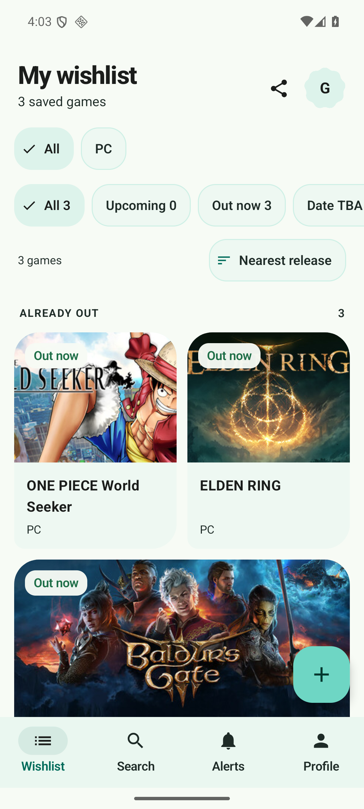
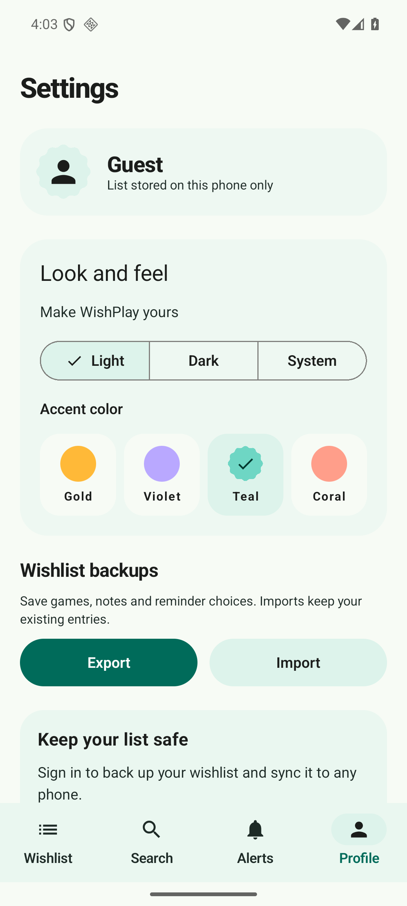
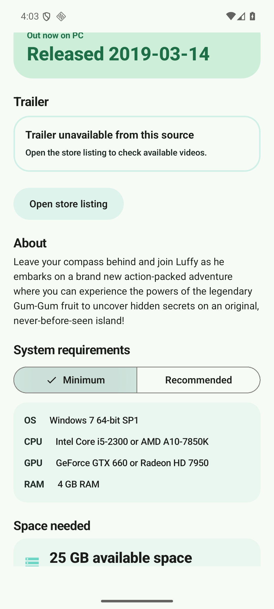
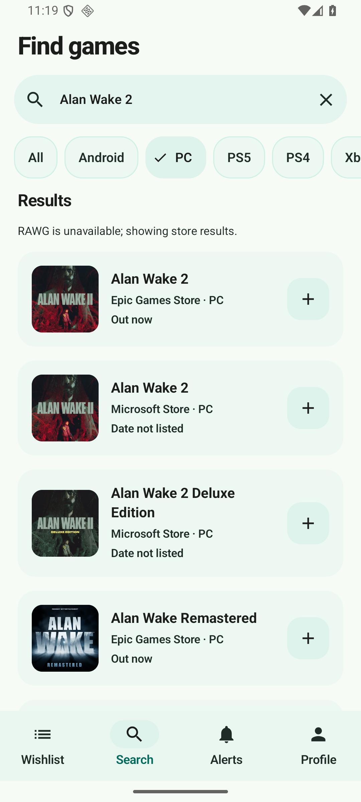
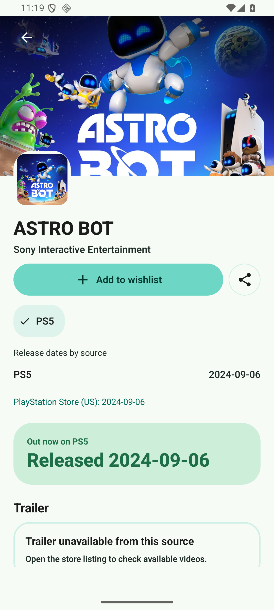

# WishPlay 🎮

[](https://android.com)
[](https://kotlinlang.org)
[](https://developer.android.com/jetpack/compose)
[](https://www.zetetic.net/sqlcipher/)
[](LICENSE)

> **Never miss a game drop.** One list for every video game you are waiting for across PC, PlayStation, Xbox, Nintendo Switch, Android, and iOS.

WishPlay is an offline-first native Android game wishlist and release tracking app designed with Google's Material 3 Expressive design tokens. It provides countdown reminders, date-change notifications, PC system requirements, trailer playback, cloud sync, and optional bKash donations. Every feature is free for guests and signed-in users.

---

## Download

[Download WishPlay 1.4.0 for Android](https://github.com/CodeByLiad/WishPlay/releases/download/v1.4.0/WishPlay-1.4.0-Jinatra.apk) · [Release notes and checksum](https://github.com/CodeByLiad/WishPlay/releases/tag/v1.4.0)

Requires Android 8.0 or later. Every feature is free. Optional bKash donations: **01978900129**.

---

## ✨ Features

- **Responsive Search:** Working providers appear immediately, recent searches are cached, stale results refresh in the background, and superseded requests cancel. Google Play featured results are included and exact matches rank first.
- **Clear Store Listings:** Store names stay visible under platform filters. Verified duplicates combine their metadata; different listings and same-name games remain identifiable. Missing dates say “Date not listed.”
- **Broader Discovery:** Independent Nintendo, PlayStation, Microsoft, and Epic catalogs supplement Google Play, Steam, App Store, and RAWG. Full Steam, Microsoft, Nintendo, PlayStation, and Epic result pages continue beyond the first response. [See the live coverage matrix and limitations](Docs/Catalog_Discovery.md).
- **PC Requirements:** Steam minimum/recommended specifications and storage sizes are shown when provided, with honest unavailable states and direct store links.
- **Multi-Platform Tracking:** Follow games across PC, PS4, PS5, Xbox Series X/S, Nintendo Switch / Switch 2, Android, and iOS. Platform membership comes from store records; release evidence identifies its source and region.
- **Offline-First & Encrypted:** Complete local functionality using Room encrypted with **SQLCipher** (256-bit AES-GCM key backed by Android Keystore).
- **Custom Games:** Add any unannounced or indie game that isn't in public databases yet with custom dates and notes.
- **Smart Alerts Engine:**
  - Automated daily checks via WorkManager.
  - Release-day reminders and configurable countdown leads (1 day, 3 days, 1 week before release).
  - Date-change detection (delays, moved dates, or returns to TBA).
  - 4 distinct Android notification channels with reboot persistence (`BootReceiver`).
- **Cloud Sync & Accounts:** Seamless Google Sign-In through Android Credential Manager. Local guest wishlists automatically merge on first sign-in.
- **Home-Screen Widget:** Interactive Jetpack Glance widget displaying the next upcoming release and a live countdown badge.
- **Material 3 Expressive UI:** Native Expressive theme, motion, Material shapes and animated buttons, morphing loading indicator, segmented controls, and readable switches. Four complete palettes work across backgrounds, cards, navigation, and controls in light/dark/system mode. The wishlist leads with game artwork, and Settings puts appearance first. See [the design system and Mobbin references](Docs/Design_System.md).
- **Completely Free:**
  - Unlimited wishlist and imports, with no paid game-count cap.
  - All accent themes, widgets, cloud sync, and supported price-drop alerts are free.
  - Optional donations through bKash number **01978900129**, with a copy-number action in Profile.
  - No upgrade, checkout, promo-code, or admin screens in the Android app.
- **Hardened & Optimized:** System certificate and hostname verification, cleartext HTTP strictly disabled, R8 full-mode minification, and in-app updater with SHA-256 + certificate matching.

---

## Interface

<p>
  
  
  
</p>

Screens captured from the running Android app. [Verification details and limits](Docs/Release_Verification.md).

Version 1.4.0 signed-APK captures show independent PC store results and PlayStation details:

<p>
  
  
</p>

---
## 🛠 Tech Stack & Architecture

- **Language:** Kotlin 2.1.10
- **UI Framework:** Jetpack Compose with Material 3 Expressive
- **Architecture:** MVVM + Clean Architecture + Repository Pattern
- **Dependency Injection:** Hilt / Dagger
- **Local Storage:** Room Database + SQLCipher + DataStore Preferences
- **Asynchronous Flow:** Kotlin Coroutines & Flow
- **Background Scheduling:** Android Jetpack WorkManager
- **Networking:** OkHttp (system TLS verification) + Kotlinx Serialization
- **Image Loading:** Coil (Disk Cache)
- **Home Widget:** Jetpack Glance 1.1.1
- **Auth:** Google Credential Manager + Firebase Auth
- **Backend:** Supabase / Firebase Cloud Functions (TypeScript)

---

## 🚀 Building & Running

### Prerequisites
- Android Studio Ladybug / Meerkat or later
- JDK 21
- Android SDK 35 (Minimum SDK: 26 / Android 8.0 Oreo)

### Build Commands
```bash
# Clone the repository
git clone https://github.com/CodeByLiad/WishPlay.git
cd WishPlay

# Run all unit test suites
./gradlew testDebugUnitTest

# Build debug APK
./gradlew assembleDebug

# Build optimized release APK (R8 full mode + resource shrinking)
./gradlew assembleRelease
```

The compiled release APK will be generated at:
`app/build/outputs/apk/release/app-release.apk`

Version 1.4.0 uses the Android application ID `com.jinatra.wishplay` and the Jinatra signing certificate in `keystore/wishplay-jinatra-release.jks`. Configure signing credentials in the untracked `local.properties`; keep the original keystore for earlier releases. Version 1.4.0 updates earlier Jinatra releases in place. Older builds with a different application ID install separately and do not share local data. Firebase is registered for this package and its signing certificates; `node scripts/register-android-app.cjs --apply` refreshes that registration using the existing local service account. Android instrumented checks `BroadDiscoveryLiveTest` and `CatalogPaginationTest` exercise the actual production adapters, multiple titles, reopened details, and later result pages. They require a connected, fully booted test emulator with network access. The older `scripts/verify-catalog.cjs` is a separate RAWG/store probe and does not cover the expanded app search.

---

## 🔒 Security & Privacy

- **Catalog Access:** The client queries RAWG and seven independent public store catalogs: Google Play, Steam, App Store, Nintendo Europe, PlayStation Store, Microsoft Store, and Epic Games Store. Supported store listings remain searchable when RAWG is unavailable, including console games. Provider deadlines and failure messages prevent indefinite loading. Store formats, regional availability, and indexing can change; no universal catalog is guaranteed complete. The RAWG client key remains bundled; moving it behind a server proxy remains separate work. [Discovery implementation and verified scope](Docs/Catalog_Discovery.md).
- **Encrypted Storage:** Room SQLite database encrypted via SQLCipher with keys in the Android Keystore.
- **No Third-Party Trackers:** Zero ad networks, zero privacy-invasive tracking SDKs.
- **Backup Exclusions:** Database and token preferences explicitly excluded from cloud backups.

---

## 👤 Author

Developed by **Md Liad** ([@mdliad-se](https://github.com/mdliad-se))  
Contact: `mdliad.se@gmail.com`
